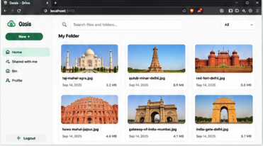
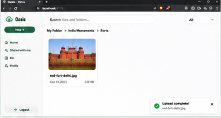
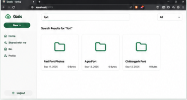
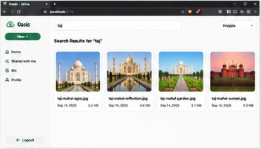
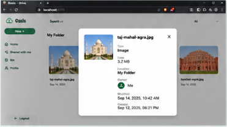
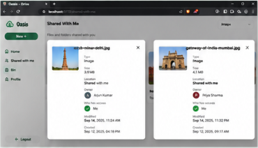
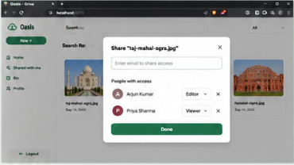
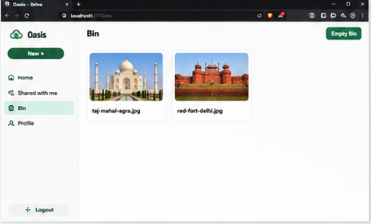
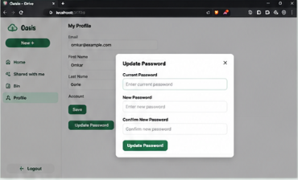
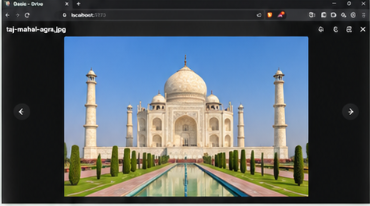

# Oasis — Cloud Storage Workspace

Oasis is a customized full-stack file-management application based on the public **G_Drive_Clone** project by **Ketan Mane**. This edition retains the source project's React/Express/MongoDB structure and existing file workflows while introducing the Oasis brand and a restrained, solid-color interface.

> **Storage implementation note:** local disk is the default. Optional private Amazon S3 storage is now wired into uploads, previews/downloads, copies, folder ZIP downloads and deletion when `STORAGE_DRIVER=s3` is configured. S3 has not been live-tested against an AWS account as part of this code review. Do not describe this version as S3-backed until that integration is implemented and tested.

## Existing functionality

- Register and sign in
- Upload files and create folders
- Navigate nested folders
- Search and filter files
- Preview and download supported files
- Share files with other registered users
- Move items to the bin, restore them, or permanently delete them
- Download folders as ZIP archives
- View profile details and update password

## Stack

- **Frontend:** React, Vite, Redux Toolkit, TanStack Query, Tailwind CSS and shadcn/ui
- **Backend:** Node.js and Express
- **Database:** MongoDB with Mongoose
- **Current file storage:** local backend disk (`backend/src/storage`)
- **Optional cloud storage:** AWS S3 can be enabled with `STORAGE_DRIVER=s3`; local disk is the default

## Run locally with Docker Compose

Requirements: Docker Engine and Docker Compose. The default `docker-compose.yml` uses a production-style Nginx frontend. For hot reload during development, use `docker compose -f dev-docker-compose.yml up --build` (frontend at `http://localhost:5173`).

1. Copy the root environment template and set a private JWT secret:

   ```bash
   cp .env.example .env
   ```

2. Edit `.env` and replace `JWT_SECRET` with a long random value. Do not commit `.env`.

3. Start the application and MongoDB:

   ```bash
   docker compose up --build
   ```

4. Open the frontend at `http://localhost` and the API at `http://localhost:8000`.

The production Compose setup builds the frontend as static assets and serves it through Nginx on `http://localhost`; Nginx proxies `/api` requests to the backend service. The backend is also exposed on `http://localhost:8000` for direct API inspection.

## Enable Amazon S3 storage (optional)

1. Create a private S3 bucket in your chosen AWS region.
2. Give the runtime IAM role permission for `s3:PutObject`, `s3:GetObject`, `s3:DeleteObject` and `s3:PutObject`/`s3:GetObject` on the bucket objects (plus `s3:ListBucket` only if your deployment needs it).
3. Set `STORAGE_DRIVER=s3`, `AWS_REGION` and `AWS_BUCKET_NAME` in the environment.
4. Restart the API. Existing local files remain local; new uploads use S3.

Do not make the bucket public. The API streams file contents only after checking the authenticated user's access. S3 storage has not been live-tested against an AWS account in this delivery. For an HTTPS deployment set `COOKIE_SECURE=true`; the provided local HTTP Compose setup explicitly sets it to `false` so browser sessions work on localhost.

## Run frontend/backend separately

Backend: copy `backend/.env.sample` to `backend/.env`, configure MongoDB and a secure `JWT_SECRET`, then run `npm ci` and `npm run dev` from `backend/`.

Frontend: copy `frontend/.env.example` to `frontend/.env`, set `VITE_API_URL=http://localhost:8000`, then run `npm ci` and `npm run dev` from `frontend/`.

## Screenshots

The `screenshots/` directory contains individual reference screenshots from the source application, not fresh browser captures of the Oasis UI.

### Dashboard



### Folder Navigation



### Search Files



### Search Files 2



### File Details



### Shared With Me



### Update Access



### Bin



### Update Password



### Preview File



## Security and deployment notes

- File lookup and file operations enforce ownership or sharing access. Sharing a folder grants read access to its descendants; inherited access does not grant write or delete rights.
- Search is scoped to the signed-in user's own files and directly shared files. Files inherited from a shared folder can be browsed within that folder.
- Uploads are limited to 100 MB and an explicit MIME allowlist. MIME headers are client-supplied and are not proof of file contents; production deployments should add file-signature inspection and malware scanning.
- Configure `FRONTEND_ORIGIN` for the actual frontend origin. The provided Docker Compose setup serves the frontend at `http://localhost`; the development Compose setup serves it at `http://localhost:5173`.
- For HTTPS deployments set `COOKIE_SECURE=true`. The supplied local HTTP Compose setup explicitly sets it to `false` so browser sessions work on localhost.
- The supplied Docker Compose setup uses named volumes for MongoDB, local uploads and thumbnails. Back up these volumes.
- For S3, keep the bucket private and use least-privilege IAM permissions. Prefer an EC2 instance role, ECS task role or local AWS profile rather than storing long-lived access keys in source files. Existing local files remain local when switching the driver; only new uploads use S3.
- Full npm installation, frontend build, MongoDB integration tests and live S3 tests still need to be run in an environment with package registry access and an AWS account. See `OASIS_REVIEW.md` for the verification record and remaining production-hardening work.
